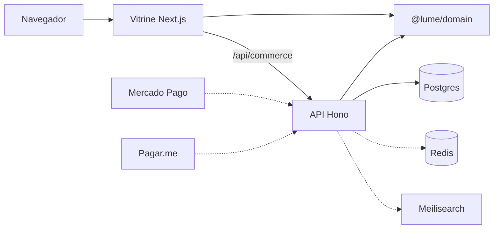
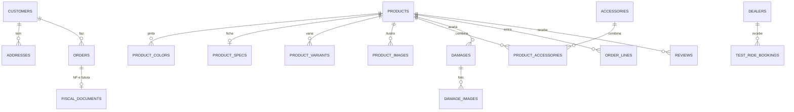

# Requisitos técnicos — LUME

Loja de motos e mobiletes elétricas. Mercado inicial: Brasil. Idioma da interface: pt-BR. Moeda: BRL. Dono do produto: Gustavo.

Os números de produto deste repositório (preço, kW, autonomia, estoque, lojas) são referência de demonstração, não homologação. Texto de habilitação e de CONTRAN fica para o jurídico antes de qualquer campanha.

## 1. O que a loja tem de vender

A LUME não é um marketplace de peças. É uma loja com a marca da casa e poucas linhas parceiras de demonstração, configuração visível e uma decisão de compra rápida: ver a moto, ver o preço, ver a parcela, pagar no Pix ou reservar um test ride.

A pesquisa visual entra como restrição de interface, não como tema para copiar.

| Referência | O que se aproveita | O que não se copia |
| --- | --- | --- |
| LiveWire | Configurador em que modelo, cor e preço mudam juntos. | A tipografia condensada pesada deixa de ser o padrão. |
| Zero | Fotografia escura, uma moto, comparação sóbria. | O tom de catálogo americano de ficha técnica. |
| Stark Future | Vídeo em tela cheia sobre preto e a ideia de “pronta para sair”. | O estoque real ainda é um selo, não um WMS. |
| Energica | Velocidade e autonomia como números grandes no hero. Um acento só no botão. | O acento deles não é o nosso. |
| Gogoro | Vender o sistema de energia, não só o veículo. | Troca de bateria no estilo taiwanês. No Brasil o sistema é tomada em casa, recarga rápida e loja. |
| Ather, Silence | Test ride como ação de marca. | Formulário escondido no rodapé. |
| Ola | Preço e reservar acima da dobra. | A linguagem de app de celular. |
| Segway | Prova social, parcela visível, “me ajude a escolher”. | Grade promocional de varejo. |
| VanMoof | Produto no centro, grafite, um detalhe vermelho, tipografia enorme e fina, menu flutuante. | A bicicleta e o vermelho espalhado em todo link. |
| Cowboy | Título enorme, estilo de vida, test ride sempre à mão. | O leasing europeu como produto. |
| Polestar | Vídeo escuro em tela cheia e a forma de pagar já na primeira dobra. | Assinatura de carro. Vira 21x e Pix. |
| Rivian | Menu em cartão flutuante e um CTA claro. | Frota de aventura. |
| Rad Power Bikes | Quiz, mapa de loja, ícones de confiança. | O visual de bicicleta utilitária. |
| Eletrycos | Busca por categoria, cidade e marca. Varejistas em círculos, como stories. | O inventário real de terceiros. As marcas parceiras da vitrine (VOLTIS, BRUMA, SENDA) são nomes de demonstração. |
| Segway, NIU, Super Soco, Yadea | Densidade de catálogo: várias carrocerias, preço de entrada e ficha curta no card. | Nome, foto e preço desses fabricantes. Nada aqui é SKU deles. |
| Voltage | 21x sem juros em evidência e Pix marcado. | A página de oferta genérica. O número entra no hero, no card e no checkout. |
| Varejo brasileiro | Pix com desconto, parcelado sem juros, frete por CEP, botão de WhatsApp, e o enquadramento por categoria: autopropelido, ciclomotor ou moto. | Prometer CNH ou placa sem o jurídico. O texto da página é referência, não parecer. |

Direção fechada: visual VanMoof/Cowboy (preto grafite, tipo fino enorme, produto flutuando, menu em cartão), configurador e filme no espírito Polestar/Rivian/LiveWire, quiz e lojas no espírito Rad, grade densa no espírito dos catálogos asiáticos, busca multimarca no espírito Eletrycos, e conversão brasileira (21x sem juros, Pix com desconto, boleto, CEP, WhatsApp, test ride, enquadramento de habilitação).

## 1.1 Plano em etapas

O dono aprovou a construção em seis etapas, cada uma num pull request empilhado sobre a anterior, sem merge até a revisão. O status de cada requisito diz em que etapa ele fecha.

1. Fundação: sistema visual, layout, home, navegação, catálogo com filtro de marca e busca, página do modelo com galeria, ficha e autonomia, e este documento com todas as referências.
2. Configurador de cor, bateria e acessório com preço ao vivo, comparador, quiz e calculadora de autonomia e de economia contra gasolina.
3. Carrinho e checkout: frete por CEP, desconto de Pix, boleto, parcelas, sandbox de Mercado Pago e Pagar.me, cupom, conta, pedidos e rastreio.
4. Simulação de financiamento, test ride, lojas com mapa, WhatsApp e pedido de troca do usado.
5. Conteúdo: CMS de demonstração, guias, legislação e CNH, reviews com foto, FAQ, garantia e agendamento de serviço.
6. Admin, SEO, analytics, desempenho, acessibilidade, LGPD, testes de ponta a ponta e guia de deploy.

## 2. Diretrizes de design

### Cor

- Fundo `#0c0c0e`. Superfície `#16161a`. Texto `#f4f4f2`. Texto secundário no mínimo `#c8c8c4`, para passar AA em corpo pequeno.
- Uma cor de ação: vermelho `#ff2d2d`, texto do botão `#1a0505`. Ela aparece no CTA principal, num ponto de 8 px da marca e num detalhe da moto. Não vira link, borda de card nem ícone decorativo.
- O verde `#32bcad` existe só no selo da palavra PIX, porque é reconhecimento do meio de pagamento, não um segundo botão.
- Cores de pintura (névoa, sal, cobre, verde circuito) são produto. Não entram no chrome.

### Tipo

- Inter Tight. Títulos em peso 200, tracking negativo, linha perto de 0,86. Corpo em 400.
- Números de preço, parcela, km/h e km em algarismos tabulares.
- Nada de caixa-alta condensada no hero. O nome do modelo pode ser grande e fino.

### Composição

- Menu flutuante, solto das bordas, com desfoque. No desktop: marca, quatro links, carrinho, um botão Reservar. No celular: marca, carrinho e Menu, que abre um diálogo.
- Hero em tela cheia. Filme escuro (canvas hoje, `public/hero.mp4` quando o filme existir). A moto em primeiro plano. Embaixo, os dois números e um cartão com 21x, total e Pix.
- Faixa fixa no rodapé da janela: “Agende um test ride”, com as cidades. Some no checkout, no próprio test ride e no admin, para não cobrir o botão de pagar.
- Busca por categoria e cidade num cartão, logo abaixo do hero e de novo no catálogo.
- Lojas como círculos horizontais (UF dentro, cidade embaixo).
- Faixa de confiança: 21x, Pix, CEP, test ride, garantia da bateria, peças. Sem ícone de estoque falso.

### Movimento

- Entrada curta no título. O 360° gira devagar e só depois do clique.
- `prefers-reduced-motion` desliga a animação do filme e deve desligar o auto-rotate quando o viewer for refeito em cima de um glTF.
- Sem bounce, sem parallax de página inteira. GSAP fica para um pin de scroll no filme, na v2, e não convive com Motion no mesmo bloco.

### Conteúdo

- Frases curtas, concretas, em pt-BR. Sem “bem-vindo”, sem lorem.
- Preço sempre em real, com centavos quando o arredondamento da parcela não for inteiro. O total sem juros é o valor cobrado. A parcela exibida é o arredondamento; a diferença de centavos não vira juros.
- Reviews de demonstração não usam nome de pessoa. Cidade e relato bastam, e a página deixa claro que são semente.

## 3. Requisitos funcionais

Identificadores estáveis para o backlog. O que está marcado como vitrine já existe na interface, com dado de demonstração ou pagamento simulado. O que continua como v1 ainda não tem integração real.

### Catálogo

- RF-CAT-01. Listar modelos com categoria, preço de entrada, autonomia, velocidade, 21x e Pix. Vitrine.
- RF-CAT-02. Filtrar por categoria (mobilete, scooter, naked, adventure, sport), por marca e por cidade da loja. A cidade filtra onde há test ride daquele modelo, não o frete. Etapa 1.
- RF-CAT-06. Marcas parceiras de demonstração na mesma grade da casa, com busca textual também no nome da marca. Não usar SKU, foto ou preço de Segway, NIU, Super Soco, Yadea ou Eletrycos. Etapa 1.
- RF-CAT-03. Busca textual simples no nome, na categoria e no texto, com ordem por preço, autonomia ou velocidade. Vitrine em memória. Meilisearch é o índice da v1.
- RF-CAT-04. Estado vazio quando a cidade não tem loja, com caminho para ver a linha inteira e seguir por CEP. Vitrine.
- RF-CAT-05. Selo de estoque por cor. Cor com estoque zero não entra no preço. Vitrine.

### Página do modelo

- RF-PDP-01. Configurador de cor e acessórios compatíveis. Trocar a cor troca o desenho e o preço no mesmo gesto. Vitrine.
- RF-PDP-02. Preço calculado no pacote `@lume/domain`: base + delta da cor + acessórios, sem duplicar acessório. O mesmo módulo roda no browser e na API. Vitrine.
- RF-PDP-03. Pix a 5% e boleto a 3% sobre o subtotal configurado. O frete não leva desconto. Vitrine.
- RF-PDP-04. 21x sem juros sobre o total configurado, campanha de lançamento. A taxa mora no código (`LAUNCH_INTEREST_FREE_UP_TO`) para o financeiro reduzir a carência sem reescrever o checkout. A Tabela Price está testada para quando o sem juros voltar a 6x. Vitrine.
- RF-PDP-05. Calculadora de autonomia: modo eco, cidade ou esporte, velocidade e peso extra. É estimativa, não ciclo de homologação, e o texto diz isso. Vitrine.
- RF-PDP-11. Galeria com vistas lateral, detalhe e frente antes do 360°. Etapa 1.
- RF-PDP-12. Ficha de habilitação por classe: autopropelido, ciclomotor ou moto, com aviso de que não é parecer jurídico. Etapa 1.
- RF-PDP-13. Opção de bateria no configurador, com delta de preço e de autonomia. A de série tem delta zero, então o preço publicado não muda até a pessoa escolher o pacote maior. Etapa 2.
- RF-PDP-14. Economia estimada contra gasolina: preço do kWh, da gasolina, km/mês e consumo do carro de referência. Estimativa, não estudo de TCO. Etapa 2.
- RF-PDP-06. Viewer 360°. Hoje é uma massa simples em React Three Fiber, carregada só no clique, com a ilustração SVG no primeiro paint. O glTF real, com fallback de fotos para Android de entrada, é v1.
- RF-PDP-07. Reservar leva a configuração ao checkout. A API recalcula e ignora preço vindo do browser. Vitrine.
- RF-PDP-08. Lista de desejos neste navegador. Vitrine. Conta de verdade sincroniza na v1.
- RF-PDP-09. Reviews do modelo e formulário moderado. A leitura da semente e o formulário estão na página. O POST existe na API e marca o relato como pendente. Se a API cair, o relato fica só no navegador. A fila de moderação é v1.
- RF-PDP-10. JSON-LD de Product/Offer em BRL. Vitrine.

### Comparar, quiz, test ride, lojas

- RF-CMP-01. Até três modelos, preço, parcela, Pix, autonomia, velocidade, bateria, peso e altura do banco. Vitrine.
- RF-QUIZ-01. Perguntas de uso, km/dia, velocidade, orçamento, tomada e garupa. Duas recomendações com motivo. Vitrine, calculado no domínio. A API expõe o mesmo contrato.
- RF-RIDE-01. Agendar test ride: modelo, loja que tenha o modelo, nome, e-mail, telefone e data. Vitrine. Confirmação humana da loja é v1.
- RF-LOJA-01. Lista de lojas e filtro por cidade, com atalho para o test ride. Endereço comercial real substitui o de demonstração. Vitrine.
- RF-LOJA-02. Mapa com coordenada. Etapa 4 plota latitude e longitude de demonstração numa projeção simples, sem tile de terceiro. O endereço comercial real continua pendente.
- RF-WA-01. Botão de WhatsApp com mensagem pronta. O número padrão é o das lojas de demonstração. Etapa 4.
- RF-TRD-01. Pedido de avaliação do usado, sem preço automático. Etapa 4.

### Carrinho, frete e checkout

- RF-CAR-01. Carrinho local com quantidade até 2, preço refeito a partir da configuração. Vitrine.
- RF-FRE-01. CEP com 8 dígitos. `00000000` é inválido. Tabela por prefixo, um serviço: transporte dedicado até em casa. Sem retirada em loja. Vitrine. Não é cotação dos Correios.
- RF-FRE-02. ViaCEP para preencher rua e cidade, e Melhor Envio ou transportadora dedicada no lugar da tabela. v1.
- RF-PAY-01. Métodos: Pix, boleto, cartão 1 a 21x. Pix e boleto são à vista. Vitrine simulada, com prévia de frete e parcela no checkout.
- RF-PAY-04. Cupom sobre o subtotal configurado, antes do desconto do meio e sem atingir o frete. Códigos de demonstração LUME10 e OFICINA. Etapa 3.
- RF-PAY-05. Sandbox sem credencial: avançar o status do pedido e deixar explícito que Mercado Pago e Pagar.me não capturaram valor. Etapa 3.
- RF-PAY-02. Provedor: Pix e boleto no Mercado Pago. Cartão parcelado na Pagar.me. Stripe fica como alternativa contratual, não como adquirente principal: no varejo brasileiro o parcelado com a mecânica de loja e o boleto estão mais maduros em Mercado Pago e Pagar.me. Interface `selectProvider` no domínio. Credencial e webhook são v1.
- RF-PAY-03. O payload de Pix de demonstração é prefixado com `LUME-MOCK-PIX` para ninguém confundir com um BR Code real.
- RF-PED-01. Código `LM` só para mostrar. A página e a lista local usam um identificador longo. Status real (pago, em transporte, entregue) vem com o webhook.
- RF-PED-02. E-mail transacional do pedido. v1.

### Conta

- RF-ACC-01. Perfil de demonstração só no navegador, sem senha e sem CPF. A sessão pede um código de uso único. Fora de produção, sem provedor de e-mail, o código fica no log da API.
- RF-ACC-02. Entrada por link mágico, sessão no servidor, pedido histórico, exclusão de conta. v1. Sem Keycloak no MVP.

### Admin e conteúdo

- RF-ADM-01. Visão de estoque por cor, variantes de bateria, banners, cupons, guias, pedidos recentes, trocas e serviços, com token. Etapa 6. O ajuste de estoque desta versão vale para a memória do processo. A vitrine lê `GET /v1/products`, então o card dos produtos dessa memória acompanha o estoque. O catálogo de domínio continua com o estoque do código. Serviço e troca ficam na mesma memória até o processo cair.
- RF-ADM-02. CRUD de produto, preço, cor, acessório, banner e pedido, com papel de operador. v1.
- RF-CMS-01. Páginas de campanha e filme editáveis no Payload, no mesmo Postgres. v1, depois que a compra funcionar. Não usar Sanity: o conteúdo ficaria fora da conta e o time passaria a operar outro idioma de conteúdo.

### Fiscal

- RF-FIS-01. Tabela `fiscal_documents` reservada, status `nao_emitida`. Sem emissão no MVP.
- RF-FIS-02. NF-e via Focus NFe, NFe.io ou eNotas, depois do desenho com o contador. Veículo tem particularidade (NF-e e o caminho de emplacamento). Não prometer data de emissão neste documento.

## 4. Requisitos não funcionais

### Performance

- LCP abaixo de 2,5 s em 4G mediano. O hero não espera o mp4: o canvas (ou o poster) pinta primeiro. O vídeo entra quando o arquivo existir e o browser puder tocá-lo.
- INP abaixo de 200 ms. O configurador não faz requisição para mudar cor ou acessório.
- CLS abaixo de 0,1. Fonte via `next/font`, preços com casa estável.
- O bundle do Three.js fica fora da home. Só o clique “Ver em 360°” o pede, por import dinâmico. Etapa 6 confirma que GSAP não entra.
- Orçamento de JavaScript da home, sem o viewer: manter o que o build já separa e não acrescentar GSAP nem um segundo player.

### SEO

- Título e descrição por modelo, `lang="pt-BR"`, canonical via `metadataBase`, Open Graph, cartão do Twitter, sitemap e robots. JSON-LD de produto, de guia e de FAQ. Rotas em português. Admin, checkout e conta fora do índice. Etapa 6.
- Páginas de modelo são o ativo de busca. Não depender de render só no cliente para o nome, o preço e o texto.

### Acessibilidade

- WCAG 2.2 AA como alvo.
- Configurador por teclado, com `aria-pressed` em cor e acessório.
- O 360° não é a única forma de ver a cor. A ilustração permanece.
- Foco visível no vermelho. Contraste do botão: texto quase preto sobre `#ff2d2d`.
- Link “Pular para o conteúdo”. O botão de WhatsApp tem nome acessível. Etapa 6.

### LGPD e consumo

- Página de privacidade com o que se coleta, a finalidade, o compartilhamento futuro, o prazo e os direitos. Vitrine. O nome do operador e do encarregado entram antes do go-live.
- Sem CPF no MVP. Sem número de cartão no nosso servidor: o cartão tokeniza no provedor.
- Carrinho e cookie explicados. O aviso oferece essencial ou medição local. O valor antigo `ok` continua aceito e não liga medição. `NEXT_PUBLIC_ANALYTICS=console` escreve o evento no console só com a escolha de medição. Sem anúncio de terceiro. Etapa 6.
- Compra online: lembrar o arrependimento de 7 dias do CDC no fluxo real, com a ressalva do jurídico para veículo.

### Segurança

- Preço e frete revalidados na API. O browser não é fonte do total.
- Zod na borda. Erro de domínio vira 400 com código estável. Erro inesperado vira 500 sem stack para o cliente.
- Fora de produção o admin ainda aceita `x-admin-token`. Em produção o cabeçalho não autentica, e o processo não sobe sem `ADMIN_TOKEN` de pelo menos 24 caracteres, diferente de `dev-admin-token`.
- Limite de checkout, test ride, consulta de pedido e login de admin. Redis quando `REDIS_URL` existe; memória do processo no resto, inclusive se o Redis falhar.
- CORS em produção só para origens listadas em `STOREFRONT_ORIGIN`. Sem a lista, nenhuma origem de browser é liberada.
- Log em JSON com `requestId`, método, caminho, status e duração. Sem e-mail, telefone ou corpo do pedido no log.
- Segredo fora do git. `.env` e `.env.local` não sobem. Exemplo sim.

### Observabilidade

- Hoje: log estruturado e `/health`.
- v1: Sentry na vitrine e na API, OpenTelemetry para o caminho de checkout, métrica de pedido criado, pagamento aprovado e cotação de frete. Web Vitals pelo próprio Next ou um endpoint interno.
- Região alvo dos dados pessoais: sa-east-1.

## 5. Arquitetura

O browser pede a página ao Next. O catálogo e a conta de preço vêm de `@lume/domain`, importado pela vitrine e pela API, então os dois não divergem. Mutação (checkout, test ride, admin) passa pela API. O Next reescreve `/api/commerce/*` para o processo da API, e o browser não precisa conhecer a porta 8787.

Postgres é o sistema de registro que o schema já descreve. O catálogo canônico de demonstração ainda é o código, o seed espelha isso no banco, e pedido, sessão, código de login, test ride, troca, serviço e estoque por cor gravam e leem no Postgres quando `DATABASE_URL` conecta. Fora de produção, sem a variável, isso fica na memória do processo. Em produção a API não sobe. Redis e Meilisearch estão no Compose para o time ligar, sem serem obrigatórios para a página abrir.

### Por que o commerce é nosso, e não Medusa ou Saleor

Saleor sai. É Python e GraphQL. O time passaria a ter dois runtimes e dois sistemas de tipos para uma loja cujo miolo é uma função de preço. GraphQL ajuda um storefront genérico. Aqui a regra é explícita: cor, acessório, Pix, parcela, CEP, e depois NF-e.

Medusa v2 é a melhor prateleira pronta em TypeScript. Cart, order, customer, inventory e region em BRL existem. O problema é o que a LUME realmente é: uma configuração, não um variant de camiseta. Esse preço viraria pipeline custom em cima do Medusa, mais o ciclo de release e o admin do framework. Os plugins de Mercado Pago e Pagar.me não cobrem o parcelado do jeito que o varejo brasileiro cobra. O admin de pedido, que é o que o Medusa oferece de melhor, ainda não é o gargalo: o gargalo é a vitrine e a regra.

Decisão: API própria em Hono, com fronteiras iguais às do Medusa (catálogo, preço, carrinho, pagamento, frete, cliente, estoque). Critério para reabrir: se na v1 o time estiver reescrevendo fila de pedido, devolução e promoção genérica em vez de integrar o adquirente, adota-se Medusa como motor de pedido e o configurador continua fora, chamando o preço nosso. Fastify é a alternativa se o time quiser o ecossistema de plugins de Node (rate limit, OpenAPI) e aceitar mais estrutura que o Hono.

Hono, e não Nest: a API cabe em um processo, os testes usam `app.request` sem socket, e o tipo é o do TypeScript. Nest paga a pena quando há dezenas de módulos e um time grande de backend. Não é o caso da fundação.

## 6. Stack

| Escolha | Por quê | Alternativa considerada |
| --- | --- | --- |
| TypeScript ponta a ponta | Um idioma. O preço no browser é o preço no servidor. | Python no commerce (Saleor) quebra isso. |
| pnpm 10 + Turborepo | Workspaces e tarefas `dev`, `lint`, `typecheck`, `test`. | Nx é mais ferramenta do que este repositório precisa. npm workspaces não dão o pipeline. |
| Next.js 16 App Router, React 19 | SEO dos modelos, Server Components no catálogo, Cache Components já ligados no scaffold. | Remix é sólido e tem menos exemplo no time de vitrine. Astro sofre no configurador. SPA pura perde LCP e busca. |
| Tailwind CSS 4 | O sistema visual cabe em token, sem um segundo kit visual. | CSS Modules funcionam e espalham o token. |
| shadcn/ui (Base UI) | Botão, campo e diálogo acessíveis, com o tema grafite por cima. | Headless próprio recria foco, teclado e diálogo. |
| Motion | Entrada do hero, integrada ao React. | GSAP na v2, só no pin do filme. Não os dois no mesmo componente. |
| React Three Fiber, Three.js, drei | 360° sob demanda. | `<model-viewer>` é mais simples e menos controlável. Spline prende o asset. Sprite 360° é o fallback de acessibilidade, não o caminho principal. |
| Hono + Zod | Borda pequena, validação na entrada, erro de domínio separado de erro de JSON. | Nest, tRPC. tRPC é tentador com o Next, e fica ruim quando o app da loja ou um parceiro precisar de HTTP estável. O contrato REST versionado em `/v1` fica. |
| Drizzle + Postgres 16 | SQL visível para o DBA, dinheiro em `integer` de centavos. | Prisma tem DX boa e um runtime mais opaco na migração. |
| Redis 7 | Carrinho quente, limite de taxa e cache de frete na v1. O Compose já sobe. | Sem Redis o processo usa memória, e isso não escala em duas instâncias. |
| Payload CMS | TypeScript, self-hosted, mesmo Postgres, na v1 de conteúdo. | Sanity é um ótimo estúdio e tira o conteúdo da conta. Strapi é um segundo app em JavaScript menos alinhado. |
| Meilisearch | Typo, faceta, pt-BR, dado na nossa rede. | Algolia é melhor de operar e pior de custo e de LGPD para um catálogo pequeno. |
| Cloudflare R2 ou S3 + CDN | Foto e, quando houver, HLS do hero (Stream ou Mux). | Servir mp4 grande do processo Next. |
| Vitest | Domínio e API, sem browser. | Jest não acrescenta nada aqui. |
| Playwright | Um fluxo: home, cor, preço, checkout. | Cypress. Playwright é o que o CI já chama. |
| GitHub Actions | Lint, tipos, teste, build e e2e no Chromium. | Outro CI só se o remoto do git não for GitHub. O workflow está em `.github/workflows/ci.yml`. |

### Deploy sugerido

- Vitrine: Vercel, o caminho mais curto para este Next, ou OpenNext se a política for não usar a Vercel. Região perto de sa-east-1.
- API: container com processo longo (Fly, Cloud Run ou ECS). Webhook de pagamento e boleto não combinam com função que morre no meio.
- Postgres: RDS em sa-east-1 se o dado tem de ficar na conta AWS. Neon se a prioridade for abrir o ambiente rápido, com a ressalva de região.
- Redis: ElastiCache ou Upstash.
- Meilisearch: um container ao lado da API.
- Segredo no cofre do provedor, não no repositório.

## 7. Modelo de dados

Dinheiro é `integer` em centavos. Não há `float` de real. A única conta com ponto flutuante é a taxa mensal da Tabela Price, arredondada uma vez de volta para centavos.

Tabelas em `apps/commerce/src/db/schema.ts` e no SQL `apps/commerce/drizzle/`:

- `customers`, `addresses` — conta e CEP. CPF não está na coluna.
- `products`, `product_specs`, `product_variants`, `product_images`, `product_colors`, `accessories`, `product_accessories`, `damages`, `damage_images` — catálogo de autopropelidos. `product_colors` fica da migration inicial; o admin usa a variante. O seed de exemplo marca `is_sample`. A vitrine lê a API, que mistura domínio e esse Postgres. O CRUD de produto grava aqui. As medidas da ficha são `numeric(12,2)` desde a migration `0005`. Sem `DATABASE_URL` a escrita responde 503.
- `dealers` — loja.
- `test_ride_bookings` — agendamento.
- `orders` — cabeçalho, método, provedor, parcelas, totais e o payload da configuração em `jsonb`.
- `reviews`, `banners` — o banner também tem `image_url`, `position` e `subtitle`.
- `fiscal_documents` — reserva, sem emissão.

O que o código de domínio trata e o schema ainda não separa em tabela própria (fica no `jsonb` do pedido até a v1): linha de acessório, pagamento e remessa. Quando o webhook existir, `payments` ganha tabela com status e id externo. Não guardar PAN nem CVV.

Índices do catálogo de autopropelidos (slug, SKU, filtro, ordem e chave estrangeira) estão na migration `0003_catalogo_integridade`, junto com check de preço e estoque e o `ON DELETE` de avarias. A `0006_consultas_loja` acrescenta, com `CREATE INDEX IF NOT EXISTS`, a vitrine (`status = ativo` e `is_enabled`, categoria, marca e preço), pedidos por data, status e e-mail, reviews por produto, e as chaves de endereço, test ride e NF-e. O check de centavos do pedido entra `NOT VALID`: linha antiga permanece, insert novo não aceita valor negativo. A `0007_acesso_operacao` acrescenta `orders.public_id`, `sessions`, `login_codes`, `exchanges`, `service_bookings` e `color_stock`, com backfill idempotente do `publicId` no payload. `product_colors (product_id, color_id)` já é único. Dinheiro continua inteiro em centavos.

Retenção: pedido e documento fiscal pelo prazo legal. Test ride sem compra, 12 meses, depois exclusão. Backup do Postgres com restore testado antes do go-live. Isso é tarefa de DBA, não de migration automática.

## 8. Roadmap

Sem calendário. A ordem é a dependência.

### Fundação — este repositório

Monorepo, domínio testado, direção visual, API com checkout simulado, Compose, CI, requisitos.

### Vitrine — este repositório

Páginas e fluxos com dado de demonstração: home, catálogo com filtro e ordem, PDP com cor, 360°, autonomia, parcelas, review e modelos próximos, comparação, quiz, WhatsApp, carrinho, checkout com prévia, conta local, pedidos, desejos e páginas institucionais. A leitura de modelo está em `apps/storefront/lib/catalog.ts` (`GET /v1/products`). A escrita continua em `lib/shop-api.ts`.

### MVP-a — cobrar de verdade

Catálogo servido pelo banco, configurador, 21x, Pix com um adquirente em homologação e depois produção, frete por CEP com ViaCEP e a tabela ou a transportadora, pedido com status, admin de estoque que a vitrine respeita, Sentry.

### MVP-b — o resto da compra

Boleto, cartão parcelado na Pagar.me com webhook, quiz e comparação já ligados ao catálogo do banco, test ride com confirmação da loja, conta por link mágico, review moderado, lista de desejos na conta, e-mail transacional.

### MVP-c — operação

Segundo adquirente se o contrato pedir, Payload para banner e página, Meilisearch, mapa de loja, LGPD operando (pedido de exclusão de verdade), observabilidade do funil.

### v2

NF-e. glTF do 360° e filme HLS com GSAP só na cena pinada. Financiamento bancário (CDC), além do parcelamento do cartão. Troca de usado. Área do dono: manual, garantia, rede de recarga. Multi-depósito. Indicação. Conteúdo editorial.

Fora de escopo até alguém reabrir: assinatura, troca de bateria no modelo Gogoro, aplicativo nativo, multi-marca.

## 9. Time

Quatro papéis. Uma pessoa pode acumular no começo. O corte é o tipo de decisão, não o organograma.

### Frontend

Dono da vitrine: App Router, o sistema visual desta diretriz, Motion, o 360°, acessibilidade e Core Web Vitals. Não inventa preço. Importa `@lume/domain` e trata erro da API. Entrega o configurador, o quiz, o checkout e os estados vazio, carregando e erro.

### Backend

Dono da API, do contrato `/v1`, dos webhooks, do provedor de pagamento e do frete. Revalida toda mutação. Não devolve stack. Mantém a fronteira pronta para um eventual Medusa sem misturar regra fiscal dentro do componente React.

### DBA

Dono do schema, da migração, do índice, do backup e da retenção. Revisa o SQL do Drizzle antes de produção. Garante centavos como inteiro, Postgres em sa-east-1, e que dado pessoal não vaza para log nem para um índice público. Não modela “só mais uma coluna jsonb” para pagamento quando o webhook chegar: aí a tabela é de verdade.

### QA

Dono do risco de regressão do configurador: cor esgotada, acessório de outro modelo, Pix contra cartão, CEP inválido, cidade sem loja, parcela de 21x batendo com o total. Automatiza o Playwright no fluxo de compra e mantém um roteiro manual no adquirente de homologação e num Android de entrada, porque o 360° é o primeiro candidato a quebrar lá. Não assina release com pagamento real sem o caso do webhook duplicado.

### Como se cruzam

Frontend e backend se encontram no `@lume/domain` e nos códigos de erro (`cep_invalido`, `cor_sem_estoque`, `parcelas_invalidas`). DBA revisa a migration antes do backend ligar o webhook. QA entra no MVP-a com o Pix de homologação, não depois do banner.

## 10. Onde isso está no código

| Assunto | Lugar |
| --- | --- |
| Preço, 21x, Pix, CEP, autonomia, quiz | `packages/domain` |
| Testes dessas regras | `packages/domain/src/domain.test.ts` |
| API | `apps/commerce/src/app.ts` |
| Schema e seed | `apps/commerce/src/db` |
| Vitrine | `apps/storefront` |
| Leitura e escrita da vitrine | `apps/storefront/lib/catalog.ts`, `apps/storefront/lib/shop-api.ts` |
| Documentação para o dono e para agentes | `docs/README.md` |
| Como rodar | `README.md` |
