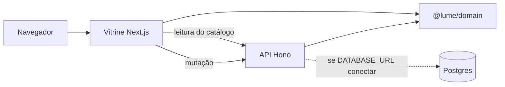

# Arquitetura

Três peças. O preço não mora na tela.

## Quem manda em quê

| Peça | Manda | Não manda |
| --- | --- | --- |
| `@lume/domain` | Preço, Pix, boleto, parcela, frete por prefixo de CEP, autonomia, quiz, catálogo de demonstração | HTTP, pixel, sessão |
| Vitrine | Apresentar, guardar carrinho neste navegador, chamar a API nas mutações | Inventar centavos |
| API | Recalcular o pedido, gravar pedido e test ride, validar com Zod | Confiar no total que o browser mandou |

A vitrine lê modelos em `GET /v1/products` por `apps/storefront/lib/catalog.ts`. Pix, boleto, parcela e a prévia de frete continuam nas funções de `@lume/domain`, aplicadas aos números da API. As escritas passam por `apps/storefront/lib/shop-api.ts`, que fala com `/api/commerce` (rewrite para o Hono). Sem a API, a página mostra erro. Não há fallback para o array de motos do código.

## De onde vem o catálogo

`GET /v1/products` junta o catálogo de `@lume/domain` com os ativos da memória do admin. O Postgres da migration continua sendo o seed do banco; o CRUD do admin ainda não grava nele. O checkout recalcula na API e ainda só encontra os modelos de `@lume/domain`. Um produto só da memória aparece na vitrine e falha no pagamento até o checkout passar a usar a mesma ficha. Estoque do admin muda o card desses produtos da memória. O estoque dos modelos de domínio segue o código.

## O que fica no navegador

Chave `lume-shop-v1`: linhas do carrinho, slugs da lista de desejos e códigos de pedido. Carrinho antigo, sem `orderCodes`, continua válido: o parse assume lista vazia.

Também locais: perfil (`lume-profile`), aviso de cookie (`lume-cookies`: `ok`, `essential` ou `analytics`), reviews pendentes (`lume-reviews-pending`), mensagens de contato (`lume-messages`) e, só enquanto o login por senha não existe, o token de admin na `sessionStorage` (`lume-admin-token`). A senha não fica no navegador. A sessão prevista é cookie httpOnly.

Nada disso é conta. Não há CPF.

## Persistência da API

Sem `DATABASE_URL`, pedido e test ride morrem quando o processo cai. Com Postgres alcançável, a API tenta gravar e, se falhar, ainda responde sucesso e registra o erro. Redis e Meilisearch sobem no Compose e não entram no caminho do pedido.
