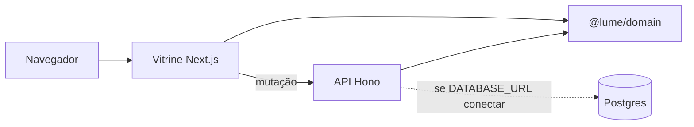

# Arquitetura

Três peças. O preço não mora na tela.

## Quem manda em quê

| Peça | Manda | Não manda |
| --- | --- | --- |
| `@lume/domain` | Preço, Pix, boleto, parcela, frete por prefixo de CEP, autonomia, quiz, catálogo de demonstração | HTTP, pixel, sessão |
| Vitrine | Apresentar, guardar carrinho neste navegador, chamar a API nas mutações | Inventar centavos |
| API | Recalcular o pedido, gravar pedido e test ride, validar com Zod | Confiar no total que o browser mandou |

A vitrine importa o domínio por `apps/storefront/lib/catalog.ts`. As escritas passam por `apps/storefront/lib/shop-api.ts`, que fala com `/api/commerce` (rewrite para o Hono). Trocar a fonte do catálogo para o Postgres é substituir as funções desses dois arquivos, não espalhar `fetch` nas páginas.

## Por que o catálogo não vem do banco hoje

A página abre com a API desligada. O configurador muda cor e acessório sem esperar a rede. O seed do Postgres espelha o mesmo catálogo, mas a vitrine não o lê. Um ajuste de estoque no admin vale para a memória do processo da API e não muda o card da loja. Isso é deliberado até o MVP-a.

## O que fica no navegador

Chave `lume-shop-v1`: linhas do carrinho, slugs da lista de desejos e códigos de pedido. Carrinho antigo, sem `orderCodes`, continua válido: o parse assume lista vazia.

Também locais: perfil (`lume-profile`), aviso de cookie (`lume-cookies`: `ok`, `essential` ou `analytics`), reviews pendentes (`lume-reviews-pending`), mensagens de contato (`lume-messages`) e, só enquanto o login por senha não existe, o token de admin na `sessionStorage` (`lume-admin-token`). A senha não fica no navegador. A sessão prevista é cookie httpOnly.

Nada disso é conta. Não há CPF.

## Persistência da API

Sem `DATABASE_URL`, pedido e test ride morrem quando o processo cai. Com Postgres alcançável, a API tenta gravar e, se falhar, ainda responde sucesso e registra o erro. Redis e Meilisearch sobem no Compose e não entram no caminho do pedido.
